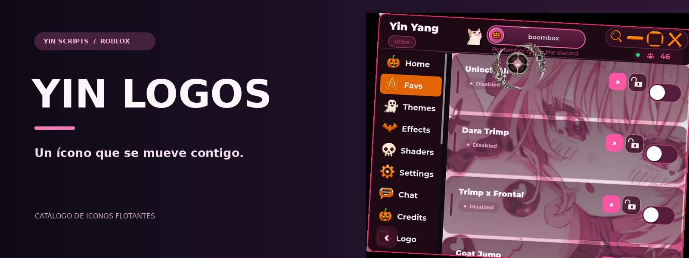

# Yin Logos ✨

**El catálogo de iconos flotantes de Yin Yang.**  
Pequeños detalles que le dan identidad a tu interfaz.

[Qué incluye](#qué-incluye) · [Catálogo](#catálogo) · [Yin UI](https://github.com/YinScripts/Yin-UI)

---

## Qué incluye

Los logos son los iconos que se pueden elegir para el botón flotante de Yin Yang. El catálogo permite combinar imágenes en capas y definir movimientos como giro, pulso, órbita, flotación o desvanecimiento. Algunas opciones también pueden incluir sonidos.

La portada muestra Yin Yang como ejemplo visual del proyecto y un icono flotante sobre la interfaz.

## Catálogo

| Archivo | Contenido |
| :--- | :--- |
| [Yin-LogosV2](Yin-LogosV2) | Catálogo utilizado por la versión actual de Yin UI. |
| [Yin-logos](Yin-logos) | Otra versión del catálogo. |
| [Audio incluido](Madoka-2026-10-26-16-15-%5Bthoughtful%2C-balanced-tone%5D-Yin-yang.mp3) | Archivo de audio del repositorio. |

El catálogo devuelve una tabla con `Version`, `Order` e `Icons`. Los detalles de configuración de capas, movimientos y sonidos se explican en los comentarios de los archivos.

## En Yin Yang

Yin UI descarga el catálogo y lo utiliza para la sección **Logo**. Su apariencia depende de la disponibilidad de los recursos y de la compatibilidad de cada opción con la interfaz.

[Conocer Yin UI →](https://github.com/YinScripts/Yin-UI)

---

Una parte del universo <b>YinScripts</b> ✨

